  

# ⚡ Awesome Event Management 🚀

> 📡 A curated, battle-tested list of leading IT Event Management, AIOps, Alert Correlation, and Observability Incident Automation platforms — featuring enterprise SaaS pricing models, free-tier limits, and top open-source alternatives.

---

## 📑 Table of Contents
- [🌐 Sector Overview & Market Dynamics](#-sector-overview--market-dynamics)
- [🏢 Enterprise SaaS Solutions](#-enterprise-saas-solutions)
- [🔓 Open-Source Event Management & AIOps Platforms](#-open-source-event-management--aiops-platforms)
- [🔍 Key Evaluation Criteria](#-key-evaluation-criteria)
- [🤝 Contributing](#-contributing)
- [📜 License](#-license)

---

## 🌐 Sector Overview & Market Dynamics

The global IT Event Management and AIOps market was valued at approximately **$13.5 billion in 2024** and is projected to surpass **$45 billion by 2032**, expanding at a robust Compound Annual Growth Rate (CAGR) of **16.5%–19.2%**. The industry operates under a **moderately fragmented** structure transitioning into high concentration: foundational enterprise IT service management and ticketing remain dominated by incumbent titans (ServiceNow, Cisco, Datadog), while modern event correlation, intelligent telemetry pipelines, and open-source AIOps layers foster fierce multi-vendor competition with specialized players capturing rapid edge growth.

---

## 🏢 Enterprise SaaS Solutions

Below is a breakdown of top commercial SaaS event management, correlation, and AIOps platforms, sorted in descending order by enterprise company size (market capitalization / enterprise valuation).

| 🏢 Platform | 💰 Company Size (Valuation / Market Cap) | 🏷️ Starting Tier Pricing | 🎁 Free Tier / Free Trial Limits | 📌 Primary Focus & Capabilities |
| :--- | :--- | :--- | :--- | :--- |
| **[ServiceNow ITOM](https://www.servicenow.com/products/it-operations-management.html)** 👔 | ~$180B Market Cap (NYSE: NOW) | Starts at **~$10,000/year** baseline (requires ServiceNow ITOM base packages; typical enterprise packages scale from $35–$60 per node/year or $50k+ contracts) | **No perpetual free tier**; 15-day to 30-day sandbox developer instance (PDI) limited to non-production testing with auto-hibernation | Enterprise ITOM, CMDB topology-driven root cause analysis, automated remediation workflows |
| **[Opsgenie (Atlassian)](https://www.atlassian.com/software/opsgenie/pricing)** 🔔 | Atlassian Subsidiary (~$45B Parent Market Cap) | Starts at **$9/user/month** (Essentials) or **$29/user/month** (Enterprise with alert deduplication and incident command) | **Perpetual Free Tier**: Up to 5 users, SMS alert limits by country, basic on-call schedules, and standard notification rules | Jira Service Management native integration, alert aggregation, and flexible on-call scheduling |
| **[Datadog Event Management](https://www.datadoghq.com/pricing/)** 🐶 | ~$38B Market Cap (NASDAQ: DDOG) | Starts at **$0.005 per event evaluated** (Event Management standalone) or Pro host monitoring at **$15/host/month** | **Perpetual Free Tier**: Up to 5 hosts with 1-day metric retention; Event Management evaluation offers a 14-day full feature free trial with all integrations | Unified telemetry, algorithmic alert clustering, and end-to-end cloud infrastructure monitoring |
| **[Cisco Splunk ITSI](https://www.splunk.com/en_us/products/it-service-intelligence.html)** 🌐 | ~$28B Acquisition Valuation (Cisco) | Starts at **$15/host/month** (Splunk Observability Cloud) or Workload Metric Units starting at **~$2,000/year** for foundational data ingest | **No perpetual free tier**; 14-day free trial limited to 5GB/day data indexing and basic ITSI service health scorecards | High-scale event ingestion, predictive machine learning analytics, and dynamic thresholding |
| **[Dynatrace](https://www.dynatrace.com/pricing/)** 🔮 | ~$15B Market Cap (NYSE: DT) | Starts at **$0.08 per hour** for Full-Stack Monitoring (8 GiB host, equivalent to ~$58.40/host/month) | **No perpetual free tier**; 15-day free trial with full access to Davis AI root cause engine and synthetic monitoring checks | Davis AI causation engine, automatic topological discovery, and deterministic anomaly detection |
| **[New Relic](https://newrelic.com/pricing)** 📊 | ~$6.5B Private Equity Valuation (Francisco Partners & TPG) | Starts at **$0.35/GB** for ingested data beyond free tier; core compute users start at **$49/user/month** | **Perpetual Free Tier**: **100 GB/month** free data ingest, 1 full-platform user, and unlimited basic users forever | Telemetry Data Platform, correlated incident views, and full-stack APM/logs integration |
| **[LogicMonitor](https://www.logicmonitor.com/pricing)** 📈 | ~$2.4B Valuation (Vista Equity Partners) | Starts at **~$15/hybrid unit (HU)/month** (Pro plan baseline, volume quoted annually) | **No perpetual free tier**; 14-day free trial with up to 50 monitored hybrid resources and alert escalation policies | Hybrid cloud & on-premises infrastructure event correlation with automated LM Envision playbooks |
| **[PagerDuty](https://www.pagerduty.com/pricing/)** 🚨 | ~$1.8B Market Cap (NYSE: PD) | Starts at **$21/user/month** (Professional tier, annual billing) or **$41/user/month** (Business tier with advanced correlation) | **Perpetual Free Tier**: Up to 5 users, free mobile app push notifications, and basic alert routing (excluding Event Orchestration AIOps) | Incident response triage, intelligent Event Orchestration rules, and on-call schedule escalations |
| **[BigPanda](https://www.bigpanda.io/pricing/)** 🐼 | ~$1.2B Private Valuation (Series E Unicorn) | Credit-based consumption model starting at **~$1,500/month** (annual contract baseline based on processed event volume) | **No perpetual free tier**; 30-day enterprise proof-of-concept (POC) sandbox upon sales qualification | Purpose-built Open AIOps, cross-source alert deduplication, and topological incident clustering |

---

## 🔓 Open-Source Event Management & AIOps Platforms

Below are leading open-source projects for event collection, alert routing, event correlation, and autonomous operations. Projects are ordered in descending order by **GitHub Star Count**.

| 📦 Repository & Stars | 🏷️ Tech Stack | 💡 Core Description | 🔗 Stargazers Page |
| :--- | :--- | :--- | :--- |
| **[Netdata](https://github.com/netdata/netdata)**  ⚡ | C, Go, Python | High-fidelity real-time performance and health monitoring with per-second event anomaly detection and sub-second metrics collection. | [🌟 Netdata Stars](https://github.com/netdata/netdata/stargazers) |
| **[Grafana](https://github.com/grafana/grafana)**  📊 | TypeScript, Go | Leading open and composable visualization platform featuring Grafana Alerting, unified alert management, and multi-source event correlation. | [🌟 Grafana Stars](https://github.com/grafana/grafana/stargazers) |
| **[Prometheus](https://github.com/prometheus/prometheus)**  📢 | Go | Cloud-native computing foundation (CNCF) standard metrics collector and time-series database powering the Alertmanager event-routing ecosystem. | [🌟 Prometheus Stars](https://github.com/prometheus/prometheus/stargazers) |
| **[Sentry](https://github.com/getsentry/sentry)**  🐛 | Python, Rust, TypeScript | Application performance monitoring and developer-first error tracking engine with automated issue clustering and trace event management. | [🌟 Sentry Stars](https://github.com/getsentry/sentry/stargazers) |
| **[Keep](https://github.com/keephq/keep)**  🛡️ | Python, TypeScript | The open-source AIOps and alert management framework that unifies alerts from all monitoring providers, correlates events, and triggers automated workflows. | [🌟 Keep Stars](https://github.com/keephq/keep/stargazers) |
| **[OpenTelemetry Collector](https://github.com/open-telemetry/opentelemetry-collector)**  🔭 | Go | High-performance vendor-neutral proxy that collects, processes, transforms, and exports telemetry logs, events, metrics, and traces. | [🌟 OTEL Stars](https://github.com/open-telemetry/opentelemetry-collector/stargazers) |
| **[StackStorm](https://github.com/stackstorm/st2)**  ⚡ | Python | Event-driven automation platform ("IFTTT for Ops") designed for automated remediation, incident responses, and self-healing DevOps operations. | [🌟 StackStorm Stars](https://github.com/stackstorm/st2/stargazers) |
| **[Zabbix](https://github.com/zabbix/zabbix)**  🖥️ | C, PHP, Go | Enterprise-grade distributed open-source real-time monitoring solution with event correlation rules and flexible proactive escalations. | [🌟 Zabbix Stars](https://github.com/zabbix/zabbix/stargazers) |
| **[Shell-operator](https://github.com/flant/shell-operator)**  🐚 | Go, Bash | Streamlined Kubernetes event-driven controller for executing custom shell scripts and automated operators triggered by cluster events. | [🌟 Shell-operator Stars](https://github.com/flant/shell-operator/stargazers) |
| **[Alerta](https://github.com/alerta/alerta)**  🚨 | Python, Vue | Scalable alert correlation and aggregation console designed to deduplicate and visualize high-frequency events from multiple monitoring silos. | [🌟 Alerta Stars](https://github.com/alerta/alerta/stargazers) |
| **[Icinga 2](https://github.com/icinga/icinga2)**  ❄️ | C++ | Multithreaded monitoring pipeline with expressive domain-specific configuration language for complex alerting and event escalation trees. | [🌟 Icinga 2 Stars](https://github.com/icinga/icinga2/stargazers) |
| **[Sensu Go](https://github.com/sensu/sensu-go)**  🎛️ | Go | Multi-cloud observability pipeline providing automated event processing, filtering, mutators, and alert handler execution. | [🌟 Sensu Go Stars](https://github.com/sensu/sensu-go/stargazers) |

---

## 🔍 Key Evaluation Criteria

When selecting an Event Management or AIOps solution, evaluate tools against these core pillars:

1. **Deduplication & Noise Reduction** 🔕: Does the engine reduce alert fatigue by at least 80% using temporal and topological correlation?
2. **Ingestion & Protocol Support** 🔌: Support for Webhooks, SNMP Traps, Syslog, OpenTelemetry (OTLP), Prometheus Alertmanager, and CloudWatch.
3. **Causality & Topology Mapping** 🗺️: Ability to ingest CMDB relationships or dynamically discover dependencies across microservices.
4. **Auto-Remediation (Self-Healing)** 🛠️: Native support for webhooks, Ansible playbooks, Kubernetes operators, and workflow triggers.
5. **Total Cost of Ownership (TCO)** 💸: Transparent pricing model avoiding punitive charges on unexpected alert storms.

---

## 🤝 Contributing

Contributions are very welcome! If you know of an awesome event management tool, AIOps engine, or correlation platform that is missing:

1. 🍴 Fork the repository.
2. 🌿 Create a feature branch (`git checkout -b feature/awesome-tool`).
3. 📝 Add your tool following the existing tabular schema (including pricing and star badge).
4. 🚀 Push to the branch and open a Pull Request.

---

## 📜 License

This repository and its curated collection are released under the [MIT License](LICENSE).
